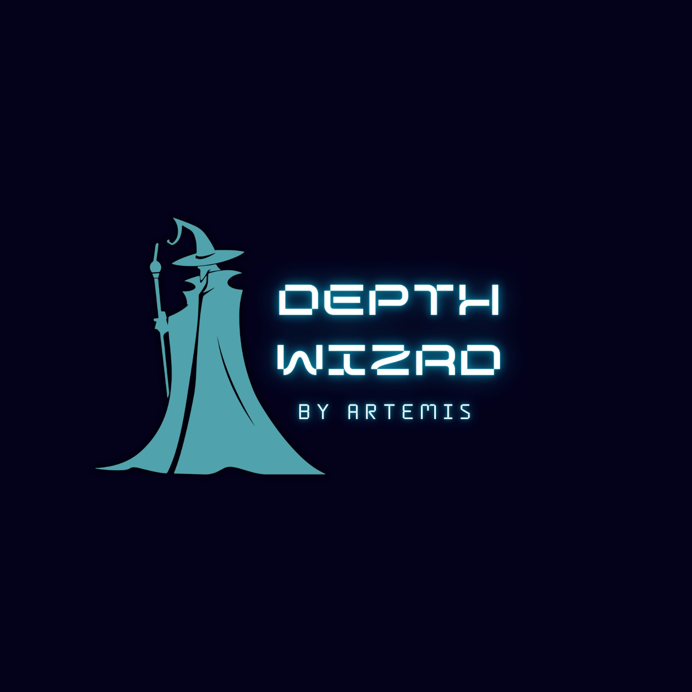
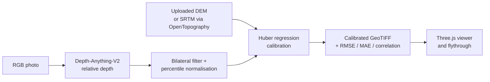

<p align="center">
  
</p>

# DepthWizard

**Single-photo height estimation, calibrated against real elevation data, with an interactive 3D terrain viewer and flythrough.**

Built for Smart India Hackathon 2026, Problem Statement 26175, by a five-member team led by Abishaya.

<!-- TODO: add a demo GIF here (upload photo -> depth map -> calibration -> 3D flythrough), 30 to 60 seconds -->

## What it does

Most depth models output *relative* depth: they know what is nearer or farther, but not by how many meters. DepthWizard turns that relative depth into **metric elevation** by anchoring it to a real elevation reference.

1. **Estimate depth** from one RGB photo with a pretrained Depth-Anything-V2 model.
2. **Get a reference** either by uploading your own georeferenced DEM or by drawing a bounding box and downloading SRTM elevation data from OpenTopography.
3. **Calibrate** the relative depth map against the reference with robust regression, and report validation error in meters.
4. **Export** a calibrated GeoTIFF and **explore** it in a Three.js viewer and first-person flythrough.



## Screenshots

<!-- TODO: add 2 to 3 screenshots: depth map result, calibration metrics screen, 3D viewer, flythrough -->

## How the pipeline works

### 1. Depth estimation: `POST /api/estimate-depth`
- Runs `depth-anything/Depth-Anything-V2-Small-hf` (pretrained, not fine-tuned) through the Hugging Face `transformers` depth-estimation pipeline.
- Applies an OpenCV **bilateral filter** to reduce texture noise while keeping real edges.
- Clips to the 2nd to 98th percentile and normalises to 0 to 1, then returns an 8-bit grayscale relative depth map.

### 2. Reference elevation: `POST /api/fetch-dem-by-bbox`
- Takes `south`, `north`, `west`, `east` (a box drawn on the map in the UI).
- Downloads **SRTM GL1 (about 30 m)** elevation for that box from the OpenTopography API as a GeoTIFF.
- Validates the box (valid ranges, at most 2 degrees per side) and returns a preview image.
- Requires an `OPENTOPOGRAPHY_API_KEY`.

### 3. Calibration: `POST /api/process-dem`
- Resamples the reference DEM to the relative depth map's grid (bilinear) and keeps pixels valid in both.
- Fits a **Huber regression** (`elevation = a * relative_depth + b`), which resists outliers better than ordinary least squares.
- Uses an **80/20 train/test split** and reports validation metrics on the held-out pixels:
  - `rmseMeters`
  - `maeMeters`
  - `correlationCoefficient`
- Writes a calibrated, compressed **GeoTIFF** (`int16`, with nodata handling) and returns elevation summary, mesh triangle count, resolution and survey area.

| Endpoint | Method | Purpose |
|---|---|---|
| `/api/health` | GET | Service health check |
| `/api/estimate-depth` | POST | RGB photo (`rgb_image`) to relative depth map |
| `/api/fetch-dem-by-bbox` | POST | Bounding box to SRTM GeoTIFF |
| `/api/process-dem` | POST | Relative depth (`relative_dem`, PNG) + reference (`absolute_dem`) to calibrated GeoTIFF and metrics |

### 4. 3D visualisation
A shared Three.js terrain engine (`src/script.js`) powers two screens:
- **DEM viewport:** orbit camera, camera presets, wireframe/render modes, solar settings and elevation exaggeration.
- **Flythrough:** chase, cockpit, orbit and top-down cameras, WASD steering, autopilot along a Catmull-Rom path, speed multipliers and waypoint pinning.

The React interface guides the user through five stages: welcome, DEM ingestion, mesh telemetry, 3D viewport, flythrough. It adapts to desktop and mobile layouts.

## Tech stack

| Layer | Tools |
|---|---|
| Backend | Python, Flask, NumPy, SciPy, scikit-learn, OpenCV, Rasterio, Hugging Face Transformers |
| Frontend | React, TypeScript, Vite, Three.js |
| Data | SRTM GL1 via OpenTopography |
| Model | Depth-Anything-V2-Small (pretrained) |

## Getting started

**Requirements:** Node.js 18+, Python 3.10+, a WebGL-capable browser.

```bash
# from the repository root
python -m pip install -r requirements.txt
npm install
cp .env.example .env        # Windows PowerShell: Copy-Item .env.example .env
```

Add `OPENTOPOGRAPHY_API_KEY` to `.env` only if you want the bounding-box DEM download. The `.env` file is git-ignored; never commit it.

```bash
npm start
```

This builds the frontend and Flask serves the full app at `http://127.0.0.1:5000`. The first run downloads the depth model, so it takes longer.

### Useful commands

```bash
npm run lint                          # TypeScript check
npm run build                         # production build
npm run --workspace frontend dev      # Vite dev server with API proxy
python backend.py                     # run the Flask server directly
```

For deployment, set `OPENTOPOGRAPHY_API_KEY`, `HOST` and `PORT` as platform environment variables.

## Results

<!-- TODO: fill in from your real runs. Example format:
| Scene | Reference | RMSE (m) | MAE (m) | Correlation |
|---|---|---|---|---|
| ...   | SRTM 30 m | ...      | ...     | ...         |
-->

## Limitations

Being upfront about what this does and does not do:

- **No fine-tuning.** The depth model is the stock pretrained Depth-Anything-V2-Small. It was not fine-tuned on aerial or building-height data (for example GAMUS), which is the biggest gap against the problem statement.
- **Domain mismatch.** General monocular depth models are trained mostly on ground-level scenes. On top-down imagery they can show texture noise and render buildings as ramps instead of blocks. Filtering reduces this but does not remove it.
- **SRTM resolution.** SRTM is about 30 m per pixel, so it can calibrate regional height but cannot resolve building-scale detail. It is used as a calibration anchor, not as ground truth for fine structure.
- **Optimistic validation.** The held-out test pixels are drawn at random from the same image, so they sit next to the training pixels. Treat the reported error as an upper bound on accuracy, not a measure of generalisation to a new scene.
- **Single linear fit.** Calibration assumes a linear relationship between relative depth and elevation across the whole image.

## Roadmap

- Fix photo-texture draping on the terrain mesh (currently in progress)
- Validate on a spatially held-out region and on a second scene
- Fine-tune the depth model on aerial imagery
- Per-region calibration instead of a single global fit

## Project structure

```
backend.py                 Flask API: depth estimation, DEM fetch, calibration
requirements.txt           Python dependencies
src/script.js              Shared Three.js terrain and flythrough engine
frontend/src/App.tsx       React workflow shell
frontend/src/api.ts        Frontend API client
frontend/src/components/   Workflow, viewer and flythrough screens
frontend/vite.config.ts    Vite config and API proxy
static/                    Generated depth maps and calibrated rasters
```

## Acknowledgements

- [Depth Anything V2](https://github.com/DepthAnything/Depth-Anything-V2) for the pretrained depth model
- [OpenTopography](https://opentopography.org/) for SRTM data access
- Smart India Hackathon 2026, Problem Statement 26175
